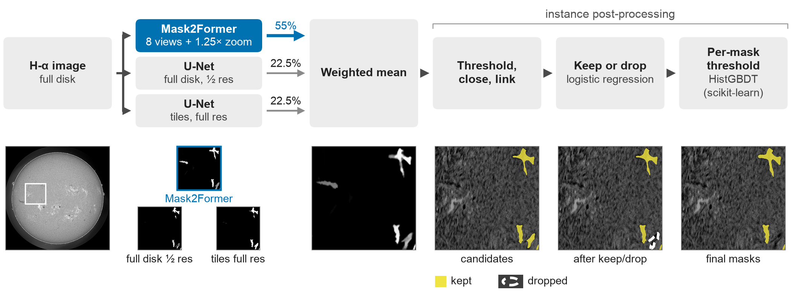

# Solar filament instance segmentation

Our solution to the Solar Filament Segmentation Challenge 2026 (IEEE BigData Cup 2026): it takes a 2048×2048 GONG H-alpha full-disk image and returns one non-overlapping mask per filament, as a competition-format CSV.



[Technical report](docs/technical_report.pdf) · [Pipeline notebook](notebooks/pipeline.ipynb) · [Competition](https://www.kaggle.com/competitions/filament-segmentation-2026)

## Reproduce the final submission

One Kaggle notebook rebuilds the submitted CSV, with no retraining and no manual downloads. It reads the networks' probability maps for the 180 test images, stored in this repository with the models that made them, and runs every later step on CPU; this makes the result exact.

1. In Kaggle, create a notebook and import [`notebooks/pipeline.ipynb`](notebooks/pipeline.ipynb) (File → Import Notebook).
2. Settings: **Internet on** (the notebook clones this repository at its release tag `v1.1`; the repository holds every weight and stored map it reads, 1.4 GB in `weights/final/`); input: only the competition data `filament-segmentation-2026`; a **CPU** runtime is enough.
3. Run all. It takes about 9 minutes on Kaggle CPU, plus installing the pinned environment.

The CSV step ends by printing `'matches_the_expected_csv': True`: the new `submission.csv` is byte-identical (same SHA-256) to the CSV we submitted ([expected hashes](docs/reproduction_notes.md#expected-results)), after the format checks (every row decodes, no empty or overlapping masks, unique ids). The last cell then draws each stage on two test images.

On a T4 GPU runtime, the notebook also re-runs the stored models on two test images and reports how closely their maps match the stored ones; re-running them on all 180 images takes about 3 h on two T4s ([reproduction notes](docs/reproduction_notes.md)).

## How it works

- **Three networks, several views.** Mask2Former (five fold models, each reading 8 flips/rotations plus a 1.25× zoom) and two U-Nets (whole disk at half resolution; native-resolution tiles) each give a filament probability map. The final submission reads these maps, stored, from `weights/final/`; `chain_maps.py` re-makes them from the models there.
- **Weighted mean.** 0.55 · Mask2Former + 0.225 · each U-Net (`chain.py`, `arithmetic.py`).
- **Candidates.** Threshold, close and link collinear pieces into non-overlapping candidates (`instancing.py`, `postproc.py`).
- **Keep or drop.** A logistic regression on 68 features of each candidate removes unlikely ones (`quality.py`, `refit.py`).
- **Per-mask threshold.** A gradient-boosted regressor picks a redraw threshold for each kept mask, then the CSV is written (`pcand.py`, `refine_ops.py`, `csv_io.py`).

All modules are in `src/filseg/reproduction/`. The [technical report](docs/technical_report.pdf) explains each stage and what it adds; [docs/reference.md](docs/reference.md) gives the constants.

## Results

| | `MODE` | CV PQ (707 training images) | Public LB | Private LB |
| --- | --- | ---: | ---: | ---: |
| **Final submission** | `"ms125"` | **0.4566** | **0.40** | **0.37** |
| Final submission with a four-classifier filter (its logistic regression averaged with LightGBM, XGBoost and CatBoost) | `"ms125m4"` | 0.4584 | 0.40 | 0.37 |
| Four-classifier filter and a four-regressor repair threshold (its gradient-boosted regressor averaged with LightGBM, XGBoost and CatBoost) | `"ms125m4r4"` | 0.4589 | 0.40 | 0.37 |
| Earlier, simpler pipeline (all networks run in the notebook) | `"pcombo"` | 0.4296 | 0.38 | 0.35 |

Mode names: `ms125` = the final recipe (Mask2Former also reads a 1.25× zoomed view); `m4` = keep/drop filter averaged over four classifiers; `r4` = repair threshold averaged over four regressors; `pcombo` = the earlier pipeline from mid-competition. The final submission is not the highest-CV row: all three `ms125` rows score 0.40 on the public leaderboard, which cannot rank them, so we kept the simplest (all three also score 0.37 on the private leaderboard).

CV PQ is pooled over all images, scoring each annotator's labels separately; the final value was measured on our own CPU server, the other three on Kaggle CPU (the two agree to 0.00001 PQ on the same run). Every submission, how to rebuild it with `MODE`, and our validation protocol: [docs/submissions.md](docs/submissions.md).

The notebook clones the release tag `v1.1`, which builds the final `"ms125"` (the default) and the earlier modes such as `"pcombo"`. `"ms125m4"` and `"ms125m4r4"` were added after that tag, on the branch `final-ms125`: run them from a checkout of that branch, or set `SOURCE_TAG = "origin/final-ms125"` in the notebook's first code cell.

## Use on new images or retrain

**New images.** Input: a folder of 2048×2048 grayscale full-disk H-alpha images (`.jpeg`, `.jpg` or `.png`; GONG format, disk centred as in the competition data; unique file names, which name the output rows). Use a fresh Python 3.13 environment with a CUDA GPU:

```bash
pip install -r requirements.txt && pip install --no-deps -e .
# Final method: maps from the 15 models in weights/final (GPU, slow: 10 views per Mask2Former model), then the CSV
python -m filseg.reproduction chain-maps --any-images --recipe ms125 --images NEW_IMAGES --output final_maps
python -m filseg.reproduction csv --any-images --mode ms125 --release final_maps --maps-from-models --images NEW_IMAGES --output out_final
# Earlier, simpler pipeline (faster): its five networks, then the CSV
python -m filseg.reproduction infer --any-images --images NEW_IMAGES --output maps
python -m filseg.reproduction csv --any-images --images NEW_IMAGES --maps maps --output out --mode pcombo
```

The output is `submission.csv` (one row per filament, COCO RLE; format in [docs/reference.md](docs/reference.md#output-format)). Other ways to run, expected hashes and determinism: [reproduction notes](docs/reproduction_notes.md).

**Retrain.** [`training/README.md`](training/README.md) gives, for each learned part (two U-Nets, Mask2Former, the keep/drop filter, the per-mask threshold), the script we ran, its inputs and outputs, and how to add labelled images. The scripts are exactly as run for our submissions; they were not re-run inside this repository. To compare a change the way we did, see [Evaluating a change](docs/submissions.md#evaluating-a-change).

## Repository layout

```
src/filseg/reproduction/  the submitted pipeline (inference only), one module per stage
src/filseg/               shared library: COCO/RLE I/O, test-set guard, folds, evaluation
notebooks/                pipeline.ipynb (the whole pipeline) and the stage notebooks it runs
weights/                  every model file, in plain git; weights/final/ = the final submission's models and stored maps
training/                 training and fitting scripts as run (not re-run here), with a how-to
configs/                  cross-validation fold assignment
scripts/, kaggle/         training-time helpers; not needed to reproduce
campaigns/                index of experiments and the two records the docs cite; not needed to reproduce
tests/                    unit tests (pytest)
docs/                     technical report, figures, reproduction notes, submissions, reference
```

## Licences

- **Code:** MIT ([LICENSE](LICENSE)). `src/filseg/vendor/miou.py` is vendored from the organizers' multiscale-IoU reference code (MIT); its header gives the provenance.
- **Our trained weights** (`weights/`, `weights/final/`): MIT, trained by us on the competition training data (MAGFiLO); use of the data follows the MAGFiLO and competition terms.
- **Starting weights:** our Mask2Former models are fine-tuned from [`facebook/mask2former-swin-tiny-coco-instance`](https://huggingface.co/facebook/mask2former-swin-tiny-coco-instance) (model-card licence `other`; the [Mask2Former code](https://github.com/facebookresearch/Mask2Former) is MIT). Our U-Net encoders start from the EfficientNet-B0 ImageNet weights that segmentation-models-pytorch 0.5.0 downloads ([`smp-hub/efficientnet-b0.imagenet`](https://huggingface.co/smp-hub/efficientnet-b0.imagenet), model-card licence `other`, from [lukemelas/EfficientNet-PyTorch](https://github.com/lukemelas/EfficientNet-PyTorch), Apache-2.0). Our weights are also subject to those terms; see the model cards.

## Citation and acknowledgments

If you use this work, please also cite the challenge and the dataset:

- A. Ahmadzadeh, D. J. Kempton, Q. Li, A. A. Pevtsov. *Solar Filament Segmentation Challenge 2026.* Kaggle, 2026. https://www.kaggle.com/competitions/filament-segmentation-2026
- A. Ahmadzadeh et al. *A dataset of manually annotated filaments from H-alpha observations.* Nature Scientific Data 11, 2024.
- A. Ahmadzadeh et al. *MAGFiLO: Manually Annotated GONG Filaments in H-Alpha Observations, V1.* Harvard Dataverse, 2024. doi:10.7910/DVN/J6JNVK

The organization of the Filament Segmentation Challenge 2026 is partially supported by the U.S. National Science Foundation (NSF) under Grant No. 2209912 and 2433781, directorate for Computer and Information Science and Engineering (CSE), and Office of Advanced Cyberinfrastructure (OAC), and Grant No. 2511630, AST Division Of Astronomical Sciences and MPS Directorate for Mathematical and Physical Sciences. The Filament Segmentation Challenge 2026 is sponsored by the U.S. National Science Foundation (NSF) National Solar Observatory (NSO).

This work utilizes GONG data obtained by the NSO Integrated Synoptic Program, managed by the National Solar Observatory, which is operated by the Association of Universities for Research in Astronomy (AURA), Inc. under a cooperative agreement with the National Science Foundation and with contribution from the National Oceanic and Atmospheric Administration. The GONG network of instruments is hosted by the Big Bear Solar Observatory, High Altitude Observatory, Learmonth Solar Observatory, Udaipur Solar Observatory, Instituto de Astrofísica de Canarias, and Cerro Tololo Interamerican Observatory.

Questions: open a GitHub issue in this repository.
