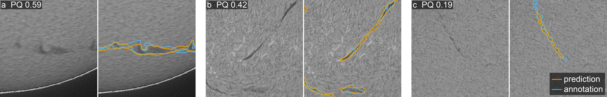
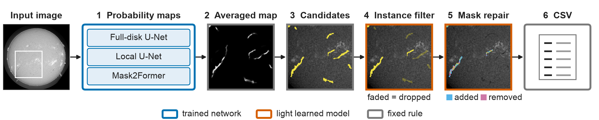

# Solar filament instance segmentation

Our solution to the Solar Filament Segmentation Challenge 2026 (IEEE BigData Cup 2026). It takes a 2048×2048 GONG H-alpha full-disk image and returns one non-overlapping mask per filament, as a competition-format CSV.

[Technical report](docs/technical_report.pdf) · [Pipeline notebook](notebooks/pipeline.ipynb) · [Competition](https://www.kaggle.com/competitions/filament-segmentation-2026) · [Reproduction notes](docs/reproduction_notes.md) · [Retraining](training/README.md)

## Which variant should I run?

| Variant | `MODE` | CV PQ ↑ (707 images) | Public LB | Runtime and hardware | Needs |
| --- | --- | ---: | ---: | --- | --- |
| **Final submission** | `"ms125"` | 0.4566 | 0.40 | about 9 min on CPU (Kaggle) | competition data only |
| Highest CV | `"ms4"` | 0.4574 | 0.40 | about 10 min on CPU (Kaggle) | competition data + release dataset (private) |
| Earlier pipeline, every map computed in the notebook | `"pcombo"` | 0.4296 | 0.38 | about 14 min on one T4 + 5 min CPU | competition data only |

- **Final submission** is the one we selected on Kaggle. Its Mask2Former maps come from five models trained on 1536-px crops, each read in 8 flips/rotations and once more at 1.25× scale.
- **Highest CV** reads the 1.25× scale in 8 views and adds a 1.5× reading: +0.0008 PQ over the final in cross-validation, but neither step passed our adoption rule.
- The **final submission** builds its CSV from probability maps stored in this repository (`weights/final/`, with the five Mask2Former and ten U-Net fold models that made them), so it is exact and needs no GPU. On a T4 the notebook also re-reads two test images with those models and shows how closely the maps match; re-reading all 180 images takes about 3 h on two T4s and gives slightly different maps (0.5–1.7 % of Mask2Former pixels in our checks, about three quarters of them by 1–2 levels of 510) ([reproduction notes](docs/reproduction_notes.md#re-running-the-networks-of-the-chain-modes)).
- The **earlier pipeline** runs every network in the notebook. It is weaker (−0.027 PQ), but it is the simplest path to adapt to new data and the one the report describes stage by stage.
- The other later submissions (such as **highest CV**) read their stored maps from the **release dataset** (models and maps, 3.8 GB, listed with hashes in `src/filseg/reproduction/data/chain/release_files.json`). That dataset is private and optional: only those other modes use it; the final submission rebuilds from this repository and the competition data.

CV PQ is pooled over all images and annotation sets, with each annotator's labels scored separately ([Validation](#validation)). Final and highest-CV values were measured on our own CPU server, the others on Kaggle CPU; the two agree to within 0.00001 PQ on the same run. All our submissions are in [Submissions](#submissions).

## Quick start (competition test set)

1. In Kaggle, create a notebook and import [`notebooks/pipeline.ipynb`](notebooks/pipeline.ipynb) (File → Import Notebook).
2. Settings: **Internet on**; input: only the competition data `filament-segmentation-2026` (the notebook clones this repository, which holds every weight and stored map the final submission reads). A CPU runtime is enough; on a GPU T4 the notebook also re-reads two test images with the stored models. The other later submissions also need the release dataset, which is private; the final submission does not.
3. Run all. It builds the final submission and ends by printing `'matches_the_expected_csv': True`. The last cell shows each stage on two test images.

To build another variant, set `MODE` in the notebook (for example `MODE = "pcombo"`, which needs only the competition data and a T4).

## Running on new images

Input: a folder of 2048×2048 grayscale full-disk H-alpha images (`.jpeg`, `.jpg` or `.png`; GONG format, disk centred as in the competition data). File names (without extension) name the output rows, so they must be unique. Use a fresh Python 3.13 virtual environment with a CUDA GPU: the launcher installs the pinned PyTorch versions into it.

```bash
pip install -r requirements.txt && pip install --no-deps -e .
# The earlier pipeline: its five networks (weights/), then the CSV
python -m filseg.reproduction infer --any-images --images NEW_IMAGES --output maps
python -m filseg.reproduction csv --any-images --images NEW_IMAGES --maps maps --output out --mode pcombo
# The final variant: its maps from the 15 models in weights/final (GPU; 8 + 2 views per Mask2Former model, so slow), then the CSV
python -m filseg.reproduction chain-maps --any-images --recipe ms125 --images NEW_IMAGES --output final_maps
python -m filseg.reproduction csv --any-images --mode ms125 --release final_maps --maps-from-models --images NEW_IMAGES --output out_final
```

**Output.** `out/submission.csv` in the competition format: a header `filament_id,segmentation_rle`, then one row per filament, `filament_id = <image name>_<k>` (k = 1, 2, … per image) and `segmentation_rle` = the COCO compressed RLE string of a 2048×2048 binary mask (column-major, as `pycocotools.mask.encode`). Masks of one image never overlap. To decode a row:

```python
from pycocotools import mask
m = mask.decode({"size": [2048, 2048], "counts": rle.encode()})   # uint8 [2048, 2048], 1 = filament
```

`out/csv_result.json` records, per image, the number of candidates, the kept masks and the hash of every stage. New images have no reference CSV, so nothing is compared.

## Retraining and evaluating a change

The learned parts are the two U-Nets, the Mask2Former models, the instance filter (a logistic regression on 68 features of each candidate) and the mask-repair regressor (gradient boosting on 64 features). [`training/README.md`](training/README.md) gives, for each, the script we ran, its inputs and outputs, and how to add new labelled images (the competition's COCO annotation format). These scripts are exactly as run for our submissions; they were not re-run inside this repository.

To evaluate a change the way we did:

- **Score each annotation set separately.** Match one prediction list to each annotator's labels (IoU > 0.5) and pool the counts over all (image, annotation set) pairs before computing PQ: `src/filseg/evaluate.py`.
- **Use temporal folds.** Images taken within 24 h of each other share a group and a fold, so near-duplicate views never sit on both sides of a split: `scripts/make_folds.py`, fold table `configs/` and `campaigns/20261110_yolo_roi_crossfold/evidence/fold_table.json`.
- **Compare paired, over 20 partitions.** Refit the light learned steps (filter, repair) in 20 random group partitions, score the held-out fifth, and adopt a change only if the paired PQ difference is positive in at least 16 of 20 partitions and its 95 % temporal-group bootstrap interval excludes zero ([Validation](#validation); scripts in `training/`).

## Known failure modes

- **Small, thin and low-contrast filaments** are the largest error: most remaining errors are missed filaments of this kind (report, Section 3).
- **The outer limb** (beyond about 90 % of the disk radius): filaments are foreshortened on a darker background, and models trained on larger crops lost recall there in our comparisons.
- **Merges and splits**: two filaments close end to end can become one mask, and a long filament with a faint middle can become two.
- **Filaments drawn by only one annotator**: each annotation set is scored on its own, so a faint filament that only one annotator drew costs a miss against that set or a false positive against the others, whatever the model does.

## Licences

- Code: MIT, see [LICENSE](LICENSE). `src/filseg/vendor/miou.py` is vendored from the organizers' multiscale-IoU reference code (MIT); its header gives the provenance.
- Our trained weights (`weights/`, `weights/final/`): MIT, as the code. They were trained by us on the competition training data (MAGFiLO); use of the data follows the MAGFiLO and competition terms (citations below).
- Mask2Former: our models are fine-tuned from [`facebook/mask2former-swin-tiny-coco-instance`](https://huggingface.co/facebook/mask2former-swin-tiny-coco-instance), so they are also subject to that model's licence. Its model card gives the licence as `other`; the Mask2Former code it comes from ([facebookresearch/Mask2Former](https://github.com/facebookresearch/Mask2Former)) is MIT. See the model card.
- U-Nets: the EfficientNet-B0 encoders start from the ImageNet weights that segmentation-models-pytorch 0.5.0 downloads for `encoder_weights="imagenet"` ([`smp-hub/efficientnet-b0.imagenet`](https://huggingface.co/smp-hub/efficientnet-b0.imagenet), model card licence `other`), which it takes from [lukemelas/EfficientNet-PyTorch](https://github.com/lukemelas/EfficientNet-PyTorch) (Apache-2.0). Our U-Net weights are also subject to those terms; see the model card.

## Example output



*Before mask repair.* Thick filaments are followed closely; thin branches and the outer parts of wide filaments are partly missed. Most of the remaining error is missed filaments, mainly small and low-contrast ones (report, Section 3).

## Pipeline


*Each block shows one stage's output on the same test image (drawn for the no-download variant; the final variant has the same stages); orange frames mark the two small learned steps.*

Three networks (a full-disk U-Net, a local U-Net and Mask2Former) each predict a filament probability map. We average the maps and cut the average into candidates. A logistic-regression instance filter removes unlikely candidates. Mask repair then redraws each kept mask at a threshold predicted for that mask. In the final variant:

1. **Probability maps.** A full-disk U-Net reads the whole disk at 1024 px; a local U-Net reads native-resolution 1024 px crops with raw, contrast-enhanced (CLAHE) and detail channels; each is the per-pixel mean of its five cross-validation fold models. Mask2Former (Swin-T, one class) was trained on 1536 px crops of the native image; each of its five fold models reads the image in 8 flips and right-angle rotations at 2048 px and in 2 views (as is and mirrored) at 2560 px, and the 10 maps are averaged.
2. **Averaged map.** p = 0.55 · Mask2Former + 0.225 · full + 0.225 · local.
3. **Candidates.** The map threshold 0.5, closing with a 21 px element, a linker that bridges collinear tips across gaps of at most 60 px, and an area limit of 256 px cut the map into non-overlapping candidates.
4. **Instance filter.** A logistic regression on 68 features from the probability maps and the raw image, in four groups (base 39, context 15, Mask2Former shape 8, neighbours 6), keeps a candidate if its probability of matching a filament reaches 0.35. It was fitted on the candidates of this averaged map on all 707 training images.
5. **Mask repair.** Each kept mask is redrawn from the averaged map inside a window aligned with it, at a repair threshold that a gradient-boosted regressor predicts for that mask from 64 features (refitted on the candidates of this map that the first filter keeps, on all 707 training images). Only pixels connected to the mask and away from other masks can change, so no mask is added, removed or made to overlap.
6. **CSV.** Each mask is run-length encoded in the competition format; the round trip is checked for every mask.

The no-download variant (`"pcombo"`) differs in stage 1 (the fold-2 U-Nets and three Mask2Former models trained on 1024 px views, one view each), stage 2 (0.25 · Mask2Former + 0.375 · full + 0.375 · local) and the fits of stages 4 and 5. The code is in `src/filseg/reproduction/`, one module per stage; `chain.py` holds the final variant's map averaging and blend, and each later submission is a recipe in `src/filseg/reproduction/data/chain/`.

## Submissions

Every `MODE` of the notebook (`--mode` on the command line) rebuilds one of our submissions and checks it against the submitted CSV. The first eight read the maps of the networks in this repository; the last ten (from `"ms125"`) read stored maps: the final `"ms125"` from `weights/final/` in this repository, the other nine from the private release dataset. The names are cumulative: "Refit: + context + neighbours" is the filter refitted with the base, context and neighbour features.


| Submission | `MODE` | CV PQ ↑, 425 images | CV PQ ↑, all 707 images | Public LB | Private LB |
| --- | --- | ---: | ---: | ---: | ---: |
| First filter, no repair | `"equivalent"` | 0.418 | 0.419 | 0.36 | after the close |
| First filter, one-threshold repair | `"pnat"` | 0.419 | 0.421 | 0.36 | after the close |
| First filter, per-object repair | `"pcand"` | 0.421 | 0.422 | 0.37 | after the close |
| Refit: + context | `"fresh_ctrl"` | 0.426 | 0.426 | 0.37 | after the close |
| Refit: + context + neighbours | `"pneigh"` | 0.426 | 0.427 | 0.37 | after the close |
| Refit: + context + Mask2Former shape | `"mfrich"` | 0.427 | 0.429 | 0.38 | after the close |
| Refit: all four groups | `"pcombo"` | 0.428 | 0.430 | 0.38 | after the close |
| All four groups + 8-view Mask2Former | `"mftta"` | 0.429 | 0.431 | 0.37 | after the close |
| **Crop-1536 Mask2Former, 8 views + 1.25× scale; refitted filter and repair; 5-fold U-Nets (final)** | **`"ms125"`** | — | **0.4566** (server) | **0.40** | after the close |
| Crop-1536 Mask2Former, 8 views + 1.25× scale in 8 views; refitted filter and repair; 5-fold U-Nets | `"ms125d4"` | — | 0.4572 (server) | 0.40 | after the close |
| Crop-1536 Mask2Former, 8 views + 1.25× (8 views) + 1.5× (4 views); refitted filter and repair; 5-fold U-Nets | `"ms4"` | — | 0.4574 (server) | 0.40 | after the close |
| Crop-1536 Mask2Former, 8 views; refitted filter and repair; 5-fold U-Nets | `"f1c15u"` | — | 0.4549 (Kaggle) | 0.40 | after the close |
| Crop-768 + crop-1024 Mask2Former, 8 views; refitted filter; 5-fold U-Nets | `"c7c10d4_un5"` | — | 0.4514 (Kaggle) | 0.40 | after the close |
| Crop-768 + crop-1024 Mask2Former; refitted filter and repair; 5-fold U-Nets | `"c7c10_refit_un5"` | — | 0.4450 (Kaggle) | 0.40 | after the close |
| Crop-768 + crop-1024 Mask2Former; refitted filter; 5-fold U-Nets | `"c7c10_un5"` | — | 0.4441 (Kaggle) | 0.40 | after the close |
| Crop-768 + crop-1024 Mask2Former; refitted filter | `"c7c10"` | — | 0.4441 (Kaggle) | 0.40 | after the close |
| Crop-768 Mask2Former; refitted filter | `"c768"` | — | 0.4402 (Kaggle) | 0.40 | after the close |
| Crop-768 Mask2Former, Mask2Former weight 0.25; refitted filter | `"c768_w25"` | — | 0.4359 (Kaggle) | 0.38 | after the close |


The later submissions (from `"ms125"`) were compared on all 707 images, so their 425-image column is left empty; "server" or "Kaggle" names the CPU that measured the value (the two agree to 0.00001 PQ on the same run). Changing only the test-time U-Net maps (the "5-fold U-Nets" rows) leaves the cross-validation unchanged, because validation always reads one out-of-fold model per network. The public leaderboard shows two decimals and does not separate these variants.

**Private leaderboard.** The private leaderboard scores will be added after the competition closes.

`"mftta"` averages each Mask2Former model of `"pcombo"` over 8 flips and right-angle rotations of its input: +0.0012 [−0.0009, +0.0033] PQ over `"pcombo"` on all 707 images (17/20 partitions) and +0.0005 [−0.0018, +0.0029] on the 425 validation images (11/20); both intervals include zero, so our rule did not adopt it.

One submission is not rebuilt here: a 2026-11-13 variant whose filter read 14 extra features from per-fold crop-768 Mask2Former maps (public 0.38); its feature code is not part of this package. Submissions made before this package existed are described in the report.

## Validation

- **Folds.** Observations at most 24 h apart are chained into one temporal group, so near-duplicate views never fall on both sides of a split. The groups form five folds (142/142/141/141/141 images). The validation set is folds 0–2: 425 images in 343 groups; we also score all 707 images (571 groups). Fold table: `campaigns/20261110_yolo_roi_crossfold/evidence/fold_table.json`.
- **Each annotation set is scored separately.** One prediction list is matched to each annotator's labels (IoU > 0.5), and true positives, false positives, false negatives and matched IoU are pooled over all (image, annotation set) pairs before PQ is computed. We never merge the annotators' labels.
- **Light learned models are cross-fitted.** The instance filter and the threshold regressor are refitted in 20 random group partitions (train on four fifths, score the fifth), and the counts are averaged over the partitions.
- **Adoption rule.** A change is adopted only if the paired PQ difference is positive, at least 16 of the 20 partitions are positive, and the 95% paired temporal-group bootstrap interval (2000 draws) excludes zero.
- **Not the leaderboard.** The public MAGFiLO v1.0 release overlaps the test images, the leaderboard shows two decimals while our decisions turned on thousandths, and its scorer differs from the host's self-evaluation notebook in undisclosed ways. `src/filseg/guard.py` pins the 180 test filenames and refuses any test annotation in training or validation.
- **Validated and deployed versions differ.** Validation uses one out-of-fold model per network; the test pipeline uses the mean of the fold models (final variant: five U-Net and five Mask2Former fold models; no-download variant: the fold-2 U-Nets and three Mask2Former models), with the filter and the regressor fitted once on all 707 training images.

The contribution of each stage, the error analysis and the rejected ideas are in the report.

## Names in the code

The report and this README use plain names. This is the only place where the code names appear.

| Plain name | Name in code |
| --- | --- |
| Probability maps: full-disk U-Net, local U-Net, Mask2Former fold models | `full`, `local`, `MF0`, `MF1`, `MF2` (`inference.py`, `models.py`) |
| Averaged map | `candidate_blend` (`arithmetic.py`) |
| Candidates | `SHIP_R3` (`instancing.py`, `postproc.py`) |
| Instance filter, first version (base features only) | `LR39` (`quality.py`, `weights/quality_model.json`) |
| Instance filter, refitted | selectors `fresh_ctrl`, `pneigh`, `mfrich`, `pcombo` (`refit.py`, `data/*_selector.json`) |
| Context, neighbour and Mask2Former-shape features | `context_features.py`, `neighbour.py`, `mfrich_features.py` |
| 8-view Mask2Former maps (second selection) | map variant `mf_variant='mftta'` and its selector `mftta` (`mfmaps.py`, `mf_d4.py`) |
| Mask repair, one threshold | `pnat` (`pnat.py`, `refine_ops.py`) |
| Mask repair, per-object threshold | `pcand` (`pcand.py`, `weights/regressor.pkl`) |
| CSV | `csv_io.py`, `validate.py` |
| Later submissions (final: ms125): stored maps, map averaging and blend weight, refitted filter and repair | chain modes, recipes `data/chain/<mode>.json` (`chain.py`) |
| Mask2Former crop-768 / crop-1024 / crop-1536 models | `c768`, `c1024`, `c1536` (release files `mfmodel_*`) |
| Default `MODE` of the notebooks | `DEFAULT_MODE` in `src/filseg/reproduction/modes.py` (ms125) |

## Requirements and environment

- `requirements.txt` pins every package the reproduction imports (Python 3.13). Installing it gives the CPU environment that builds the CSV; it equals `requirements-reproduce-cpu.txt`.
- The networks run in two more environments, because they were trained under different library versions: `requirements-reproduce-unet.txt` for the U-Nets (torch 2.11.0, segmentation-models-pytorch 0.5.0) and `requirements-reproduce-gpu.txt` for Mask2Former (torch 2.14.1, transformers 4.57.1). The launcher (`filseg.reproduction.launch`) installs each one and runs it in a fresh process.
- The GPU is used only for the probability maps; everything after them runs on CPU. The later submissions (`"ms125"` and after) need no GPU when their stored maps are attached.
- **scikit-learn must be 1.6.1**, the version that saved the threshold regressor; any other version stops with an error.
- Deterministic mode is on by default: fixed seeds, deterministic CUDA kernels and a sorted image order.

## Weights and release files

`weights/` holds every file the pipeline loads, in plain git (no LFS), so a normal clone is enough. Each Mask2Former file is stored as parts of at most 48 MB in `weights/parts/`. On first use the parts are reassembled and every part and file is checked against `weights/repo_weights.json`; the loader then checks every file against `weights/reproduction_weights.json` before loading. Any mismatch stops the run. The filter coefficients are in `src/filseg/reproduction/data/`, also hash-checked.

`weights/final/` holds, the same way, everything the final submission reads: its five crop-1536 Mask2Former fold models (as 48 MB parts), the ten U-Net fold checkpoints with their test maps, the ten stored Mask2Former test-map archives and the 5-fold-mean U-Net maps (1.4 GB in all, `weights/final/repo_weights.json`). The other later submissions need more than fits in git (15 Mask2Former models and 40 map archives); they read the optional **release files** (one private dataset, 3.8 GB, a superset of `weights/final/`), listed with bytes and SHA-256 in `src/filseg/reproduction/data/chain/release_files.json`. Every file is found by its name and hash-checked before use. The small learned files of each recipe (filter coefficients, repair regressor) are in `src/filseg/reproduction/data/chain/`.

## Repository layout

| Folder | Contents |
| --- | --- |
| `src/filseg/reproduction/` | The submitted pipeline, inference only, one module per stage. |
| `src/filseg/` | Shared library: COCO/RLE input and output, the test-set guard, fold splits, instancing and evaluation helpers. |
| `notebooks/` | `pipeline.ipynb` (the whole pipeline), and the stage notebooks it runs. |
| `weights/` | Every model file the pipeline loads; `weights/final/` holds the final submission's models and stored maps. |
| `configs/` | The cross-validation fold assignment used for training. |
| `scripts/`, `kaggle/` | Training-time helpers: fold making, Kaggle kernel builders, out-of-fold reports. Not needed to reproduce. |
| `training/` | The training and fitting scripts as run for our submissions (not re-run here), with a how-to. |
| `tests/` | Unit tests (`pytest`). |
| `report/` | The outline the technical report was planned from. |
| `docs/` | The technical report (`technical_report.pdf`), figures and the reproduction notes (other ways to run, hashes, determinism, training recipe). |
| `campaigns/` | An index of the experiments (what was tried, the outcome) and the two records these docs cite. Not needed to reproduce. |

## Questions

Open a GitHub issue in this repository.

## Citation and acknowledgments

If you use this work, please also cite the challenge and the dataset:

- A. Ahmadzadeh, D. J. Kempton, Q. Li, A. A. Pevtsov. *Solar Filament Segmentation Challenge 2026.* Kaggle, 2026. https://www.kaggle.com/competitions/filament-segmentation-2026
- A. Ahmadzadeh et al. *A dataset of manually annotated filaments from H-alpha observations.* Nature Scientific Data 11, 2024.
- A. Ahmadzadeh et al. *MAGFiLO: Manually Annotated GONG Filaments in H-Alpha Observations, V1.* Harvard Dataverse, 2024. doi:10.7910/DVN/J6JNVK

The organization of the Filament Segmentation Challenge 2026 is partially supported by the U.S. National Science Foundation (NSF) under Grant No. 2209912 and 2433781, directorate for Computer and Information Science and Engineering (CSE), and Office of Advanced Cyberinfrastructure (OAC), and Grant No. 2511630, AST Division Of Astronomical Sciences and MPS Directorate for Mathematical and Physical Sciences. The Filament Segmentation Challenge 2026 is sponsored by the U.S. National Science Foundation (NSF) National Solar Observatory (NSO).

This work utilizes GONG data obtained by the NSO Integrated Synoptic Program, managed by the National Solar Observatory, which is operated by the Association of Universities for Research in Astronomy (AURA), Inc. under a cooperative agreement with the National Science Foundation and with contribution from the National Oceanic and Atmospheric Administration. The GONG network of instruments is hosted by the Big Bear Solar Observatory, High Altitude Observatory, Learmonth Solar Observatory, Udaipur Solar Observatory, Instituto de Astrofísica de Canarias, and Cerro Tololo Interamerican Observatory.
