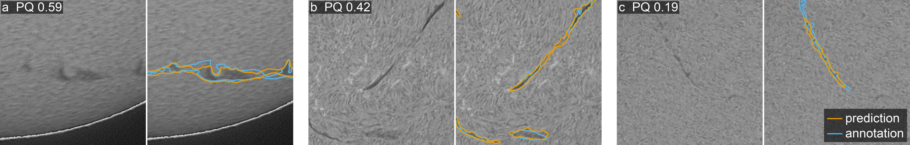

# Reference

Details behind the [README](../README.md): each stage with its constants, the output format, the names used in the code, the environments, how the weights are stored, and where the method fails. For other ways to run the pipeline, the expected hashes and the training recipe, see the [reproduction notes](reproduction_notes.md).

## Pipeline in detail

Three networks (a full-disk U-Net, a local U-Net and Mask2Former) each predict a filament probability map. We average the maps and cut the average into candidates. A logistic-regression instance filter removes unlikely candidates. Mask repair then redraws each kept mask at a threshold predicted for that mask. In the final variant:

1. **Probability maps.** A full-disk U-Net reads the whole disk at 1024 px; a local U-Net reads native-resolution 1024 px crops with raw, contrast-enhanced (CLAHE) and detail channels; each is the per-pixel mean of its five cross-validation fold models. Mask2Former (Swin-T, one class) was trained on 1536 px crops of the native image; each of its five fold models reads the image in 8 flips and right-angle rotations at 2048 px and in 2 views (as is and mirrored) at 2560 px, and the 10 maps are averaged.
2. **Averaged map.** p = 0.55 · Mask2Former + 0.225 · full + 0.225 · local.
3. **Candidates.** The map threshold 0.5, closing with a 21 px element, a linker that bridges collinear tips across gaps of at most 60 px, and an area limit of 256 px cut the map into non-overlapping candidates.
4. **Instance filter.** A logistic regression on 68 features from the probability maps and the raw image, in four groups (base 39, context 15, Mask2Former shape 8, neighbours 6), keeps a candidate if its probability of matching a filament reaches 0.35. It was fitted on the candidates of this averaged map on all 707 training images.
5. **Mask repair.** Each kept mask is redrawn from the averaged map inside a window aligned with it, at a repair threshold that a gradient-boosted regressor predicts for that mask from 64 features (refitted on the candidates of this map that the first filter keeps, on all 707 training images). Only pixels connected to the mask and away from other masks can change, so no mask is added, removed or made to overlap.
6. **CSV.** Each mask is run-length encoded in the competition format; the round trip is checked for every mask.

The no-download variant (`"pcombo"`) differs in stage 1 (the fold-2 U-Nets and three Mask2Former models trained on 1024 px views, one view each), stage 2 (0.25 · Mask2Former + 0.375 · full + 0.375 · local) and the fits of stages 4 and 5. The code is in `src/filseg/reproduction/`, one module per stage; `chain.py` holds the final variant's map averaging and blend, and each later submission is a recipe in `src/filseg/reproduction/data/chain/`.

## Output format

`submission.csv` in the competition format: a header `filament_id,segmentation_rle`, then one row per filament, `filament_id = <image name>_<k>` (k = 1, 2, … per image) and `segmentation_rle` = the COCO compressed RLE string of a 2048×2048 binary mask (column-major, as `pycocotools.mask.encode`). Masks of one image never overlap. To decode a row:

```python
from pycocotools import mask
m = mask.decode({"size": [2048, 2048], "counts": rle.encode()})   # uint8 [2048, 2048], 1 = filament
```

`csv_result.json` (next to the CSV) records, per image, the number of candidates, the kept masks and the hash of every stage. New images have no reference CSV, so nothing is compared.

## Names in the code

The report and the README use plain names. This table maps them to the code names.

| Plain name | Name in code |
| --- | --- |
| Probability maps: full-disk U-Net, local U-Net, Mask2Former fold models | `full`, `local`, `MF0`, `MF1`, `MF2` (`inference.py`, `models.py`) |
| Averaged map | `candidate_blend` (`arithmetic.py`) |
| Candidates | `SHIP_R3` (`instancing.py`, `postproc.py`) |
| Instance filter, first version (base features only) | `LR39` (`quality.py`, `weights/quality_model.json`) |
| Instance filter, refitted | selectors `fresh_ctrl`, `pneigh`, `mfrich`, `pcombo` (`refit.py`, `data/*_selector.json`) |
| Context, neighbour and Mask2Former-shape features | `context_features.py`, `neighbour.py`, `mfrich_features.py` |
| 8-view Mask2Former maps (second selection) | map variant `mf_variant='mftta'` and its selector `mftta` (`mfmaps.py`, `mf_d4.py`) |
| Mask repair, one threshold | `pnat` (`pnat.py`, `refine_ops.py`) |
| Mask repair, per-object threshold | `pcand` (`pcand.py`, `weights/regressor.pkl`) |
| CSV | `csv_io.py`, `validate.py` |
| Later submissions (final: ms125): stored maps, map averaging and blend weight, refitted filter and repair | chain modes, recipes `data/chain/<mode>.json` (`chain.py`) |
| Mask2Former crop-768 / crop-1024 / crop-1536 models | `c768`, `c1024`, `c1536` (release files `mfmodel_*`) |
| Default `MODE` of the notebooks | `DEFAULT_MODE` in `src/filseg/reproduction/modes.py` (ms125) |

## Requirements and environment

- `requirements.txt` pins every package the reproduction imports (Python 3.13). Installing it gives the CPU environment that builds the CSV; it equals `requirements-reproduce-cpu.txt`.
- The networks run in two more environments, because their libraries need different versions: `requirements-reproduce-unet.txt` for the U-Nets (torch 2.11.0, segmentation-models-pytorch 0.5.0) and `requirements-reproduce-gpu.txt` for Mask2Former (torch 2.14.1, transformers 4.57.1). These pin the re-run on Kaggle; the final Mask2Former models were trained, and their stored maps made, under torch 2.5.1 ([training/README.md](../training/README.md)). The launcher (`filseg.reproduction.launch`) installs each one and runs it in a fresh process.
- The GPU is used only for the probability maps; everything after them runs on CPU. The later submissions (`"ms125"` and after) need no GPU when their stored maps are attached.
- **scikit-learn must be 1.6.1**, the version that saved the threshold regressor; any other version stops with an error.
- Deterministic mode is on by default: fixed seeds, deterministic CUDA kernels and a sorted image order.

## Weights and release files

`weights/` holds every file the pipeline loads, in plain git (no LFS), so a normal clone is enough. Each Mask2Former file is stored as parts of at most 48 MB in `weights/parts/`. On first use the parts are reassembled and every part and file is checked against `weights/repo_weights.json`; the loader then checks every file against `weights/reproduction_weights.json` before loading. Any mismatch stops the run. The filter coefficients are in `src/filseg/reproduction/data/`, also hash-checked.

`weights/final/` holds, the same way, everything the final submission reads: its five crop-1536 Mask2Former fold models (as 48 MB parts), the ten U-Net fold checkpoints with their test maps, the ten stored Mask2Former test-map archives and the 5-fold-mean U-Net maps (1.4 GB in all, `weights/final/repo_weights.json`). The other later submissions need more than fits in git (15 Mask2Former models and 40 map archives); they read the optional **release files** (one private dataset, 3.8 GB, a superset of `weights/final/`), listed with bytes and SHA-256 in `src/filseg/reproduction/data/chain/release_files.json`. Every file is found by its name and hash-checked before use. The small learned files of each recipe (filter coefficients, repair regressor) are in `src/filseg/reproduction/data/chain/`.

## Known failure modes

- **Small, thin and low-contrast filaments** are the largest error: most remaining errors are missed filaments of this kind (report, Section 3).
- **The outer limb** (beyond about 90 % of the disk radius): filaments are foreshortened on a darker background, and models trained on larger crops lost recall there in our comparisons.
- **Merges and splits**: two filaments close end to end can become one mask, and a long filament with a faint middle can become two.
- **Filaments drawn by only one annotator**: each annotation set is scored on its own, so a faint filament that only one annotator drew costs a miss against that set or a false positive against the others, whatever the model does.



*Before mask repair.* Thick filaments are followed closely; thin branches and the outer parts of wide filaments are partly missed. Most of the remaining error is missed filaments, mainly small and low-contrast ones (report, Section 3).
